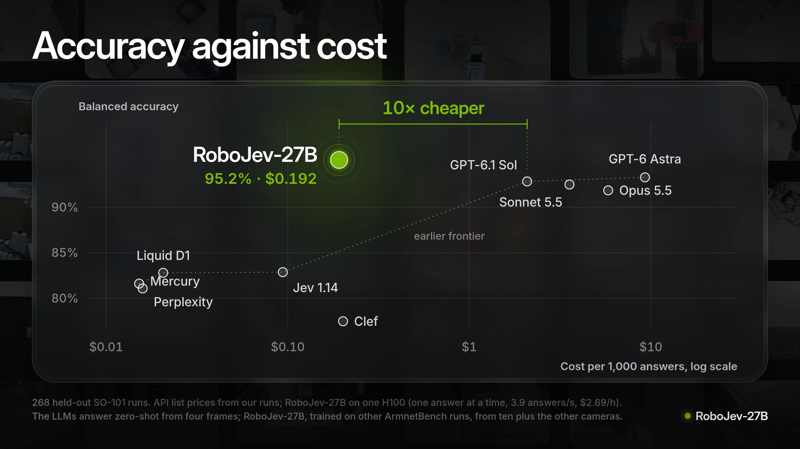
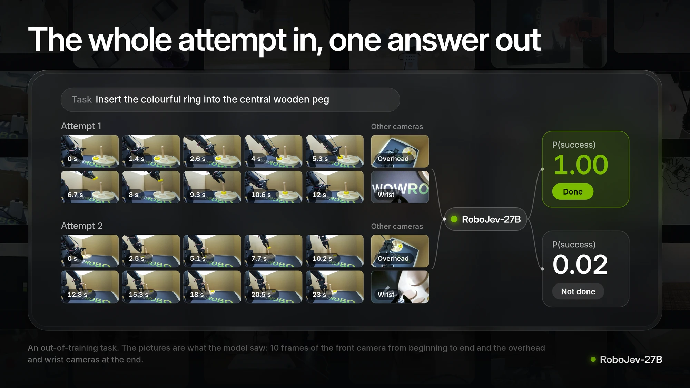

# RoboJev

Did the robot complete the task? RoboJev-27B takes a task instruction and ten frames of an attempt and returns P(task completed). Optional final frames from other cameras can provide another view of the outcome.

**[Project and paper](https://robo-jev.com)** &nbsp;·&nbsp; **[Try your video — no account needed](https://robo-jev.com/demo)** &nbsp;·&nbsp; **[HF demo](https://huggingface.co/spaces/josefchen/RoboJev-demo)** &nbsp;·&nbsp; **[Every result](https://huggingface.co/spaces/josefchen/RoboJev-data)** &nbsp;·&nbsp; **[Evaluation data](https://huggingface.co/datasets/josefchen/RoboJev-evals)** &nbsp;·&nbsp; **[Model card](https://huggingface.co/josefchen/RoboJev-27B)**

<picture><source media="(max-width: 700px)" srcset="assets/cost-tall.webp"></picture>

On the 268 held-out SO-101 runs, RoboJev-27B achieves 95.2% balanced accuracy at a cost of $0.19 per 1,000 answers. GPT-6 Astra, GPT-6.1 Sol, Claude Opus 5.5, and Claude Sonnet 5.5 achieve 91.9%-93.3% balanced accuracy at a cost of $2.08-$9.29 per 1,000 answers. The measured balanced-accuracy gap to GPT-6 Astra is 1.91 percentage points, with a paired 95% interval that includes zero. Its measured API cost is about 48 times higher.

The language models all received the same question from four frames of the main camera, while RoboJev-27B read ten frames plus the other cameras. Costs use API list prices from our runs and one H100 at $2.69 an hour for RoboJev-27B. The 0.26-second median measures serial H100 inference; it excludes media processing and serving overhead. The shared HF demo also has GPU queue and cold-start time.

All model responses are in the [data explorer](https://huggingface.co/spaces/josefchen/RoboJev-data) and the [model card](https://huggingface.co/josefchen/RoboJev-27B) contains the full tables and explains the methodology.

RoboJev-27B: Model card, benchmarks, weights available on Hugging Face. The code for the Python client, dataset grader, video overlay, and LeRobot plugin for RoboJev-27B can be found in this repo.

## Try it first

- **Browser, no local GPU:** [robo-jev.com/demo](https://robo-jev.com/demo) accepts a task and one video without an HF account. The project sponsors this low-demand demo; shared GPU availability and request limits apply.
- **Recorded examples:** the [HF demo](https://huggingface.co/spaces/josefchen/RoboJev-demo) opens with two real ring attempts and their saved model scores. These examples need no account or GPU. Scoring a new upload directly on HF uses the visitor's HF account and GPU quota.
- **Python or CLI:** install this client and connect to your own or an explicitly authorised vLLM server below. The client is CPU-only; the model server needs a GPU. The website demo URL is not an OpenAI-compatible vLLM endpoint.

## Install

Python 3.10 or newer is required for the small client. Install the current source to get the documented CLI options:

```bash
git clone https://github.com/josefchen/robojev.git
cd robojev
python -m pip install -e .
```

Videos require both `ffmpeg` and `ffprobe` on your PATH (for example, `brew install ffmpeg` on macOS or `sudo apt install ffmpeg` on Debian/Ubuntu). Image-list inputs need neither. Install `python -m pip install ".[v3]"` for LeRobot v3.0 metadata or `python -m pip install ".[camera]"` for a live camera. The published `pip install robojev` package also provides the Python API, but may lag the current source CLI.

## Use it

On a GPU host, install [vLLM](https://docs.vllm.ai/en/latest/getting_started/installation/) in its own suitable environment, then serve the model. BF16 weights are about 54.7 GB; the released setup uses one 80 GB GPU, with additional memory needed for serving. This command downloads the weights on first use.

```bash
vllm serve josefchen/RoboJev-27B \
  --revision e089a9b69a365744b80765057d86583647af95a9 \
  --served-model-name robojev --max-model-len 32768 \
  --limit-mm-per-prompt '{"image": 16}' --logprobs-mode processed_logprobs --trust-request-chat-template
```

```python
from robojev import RoboJev

judge = RoboJev("http://localhost:8000")
judge.done("Put the ring on the peg", "attempt.mp4")          # cuts ten frames from the video
judge.done("Put the ring on the peg", frames)                 # or pass ten frames, start to end
judge.done("Put the ring on the peg", "attempt.mp4",
           views={"wrist": "wrist_last.jpg"})                 # with other cameras' last frames
```

The `done` method returns one probability for the whole supplied attempt. Connect to a remote server by passing its base URL to `RoboJev("http://gpu-host:8000")`; use the Python `headers` argument if that server requires authentication. The HTTP client does not load model weights.

Making the same call from a shell works, and displays the probability of having successfully completed the task.

```bash
robojev "Put the ring on the peg" attempt.mp4 --server http://localhost:8000
robojev --help
```

To use the same released ring example as the demo (ArmnetBench episode 37, Apache-2.0):

```bash
curl -L --fail -o ring-success.mp4 \
  https://huggingface.co/spaces/josefchen/RoboJev-demo/resolve/1cf2d202804d50f25af8d7a2da52d4a3c1acf176/examples/ring-success.mp4
robojev "Insert the colourful ring into the central wooden peg" ring-success.mp4 \
  --server http://localhost:8000
```

That command makes a fresh request to your server. It does not replay the HF demo's saved answer, and a different serving setup or adding auxiliary cameras can change the probability.

If you want to draw the probability on a video or live camera input:

```bash
robojev-overlay "Put the ring on the peg" attempt.mp4 out.mp4
robojev-overlay "Put the ring on the peg" --camera 0       # requires opencv-python
```

## Grade a LeRobot dataset

The command below will grade all episodes in a LeRobot dataset on the Hub. Note that the server must be running.

```bash
robojev-grade owner/eval_dataset --server http://localhost:8000 --out results.csv
```

For each episode, the command prints the episode index, task, P(done), and verdict (Done or Not yet). The summary includes the number graded, the success rate at the threshold (default = 0.5), and how many episodes are worth a look (with P(done) between 0.2 and 0.8). Results can also be saved as CSV with the `--out` option.

It will pick a 3rd person camera and parse ten frames/episode via HTTP byte ranges. Use `--camera` to specify a camera, `--episodes` to specify episodes, and `--header` for additional server headers. No token is required for public datasets, but set `HF_TOKEN` when using private ones. LeRobot v2.0 and v2.1 require requests, pillow and ffmpeg, and v3.0 also requires `pyarrow` to read its Parquet episode metadata.

## LeRobot

The [`lerobot_plugin`](lerobot_plugin/README.md) directory provides a reward-model adapter for scoring recorded episodes and an experimental processor that scores the attempt so far. Both call your vLLM server over HTTP. The processor is not validated as a robot safety or control mechanism; we have not demonstrated improved policy learning. Its threshold can fire before a transient success is undone, so whole-episode evaluation is the supported starting point.

The plugin can also be installed with pip directly from the repository.

```bash
pip install "git+https://github.com/josefchen/robojev#subdirectory=lerobot_plugin"
```

## How it works

<picture><source media="(max-width: 700px)" srcset="assets/how-tall.webp"></picture>

Task is sent as free text, along with the video. Client samples 10 frames from the main camera uniformly between the first and last frame. You can optionally add the last frame from each additional camera. No text output from the model. Instead, the model outputs a probability, p(true), at the answer token. This means each answer requires only a single forward pass.

The model doesn't actually generate anything. We just stop the prompt at `[decision]:`, and the client reads the log-probs of the tokens `false` and `true` at that position, adds the biases from `decision.json`, divides by the temperature and applies a softmax. `decision.json` also contains the number of frames the model reads.

## Limitations

- The weakest performance of RoboJev-27B is in wrist cameras and on long horizon tasks like stirring or folding.
- RoboJev-27B can only see what you show it. If the video cuts off before the result, its answer is no good.
- When using just the final frame as input, RoboJev-27B performs worse on new robots, achieving an AUROC of 0.776 on the unseen labs.
- On unseen labs/robots, RoboJev-27B has AUROC 0.890 versus 0.900 for JEV-27B-VL with the same inputs; adaptation has not demonstrated a transfer benefit. Its probabilities are also less well calibrated on unseen domains, so validate any deployment threshold locally.
- Some community training labels come from two teacher models and may contain errors. Separately, the community evaluation contains 200 manually labelled clips: 135 have a clear binary outcome and contribute to metrics; 65 are ambiguous and are excluded. This evaluation does not establish the accuracy of every training label.
- RoboJev-27B is not a safety measure.

## Tests

```bash
pip install -e ".[test]"
pytest
```

These tests use a mock vLLM server instead of an actual GPU-based model server. This allows them to validate the functionality without requiring a GPU.

## License

Like the weights, the code in this repository is licensed under Apache-2.0. For licenses of the data used for training, see the model card.
